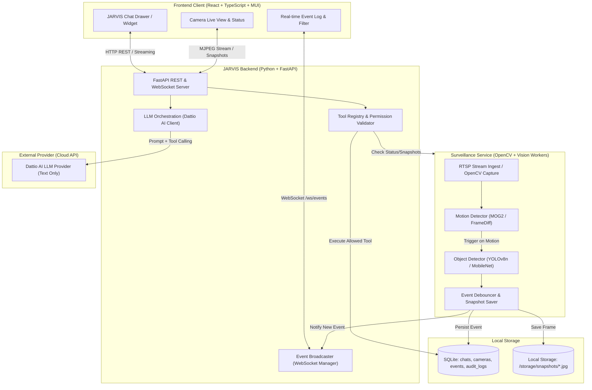

# JARVIS — System Architecture

## 1. High-Level Architecture

JARVIS dirancang dengan pendekatan modular *local-first*, memisahkan *Surveillance Pipeline* dari *AI Conversation Engine* agar kegagalan LLM atau jaringan tidak menghentikan deteksi kamera.

---

## 2. Service Boundaries & Decoupling

### 2.1 AI Core & Backend (FastAPI)
- **Tanggung Jawab**:
  - Menyediakan endpoint REST API untuk manajemen kamera, riwayat chat, riwayat event, dan status sistem.
  - Mengelola koneksi WebSocket untuk siaran event real-time ke client.
  - Mengorkestrasikan percakapan: menerima pesan user, menginjeksi prompt konteks & metadata alat, memanggil Dattio AI API.
  - Memvalidasi dan mengeksekusi tools melalui `ToolRegistry` dengan prinsip *Least Privilege*.
  - Menyediakan storage layer menggunakan SQLite (via SQLAlchemy / SQLModel / aiosqlite).

### 2.2 Surveillance & Computer Vision Service
- **Tanggung Jawab**:
  - Berjalan sebagai worker background independen (multithreaded/multiprocess) di dalam backend runtime.
  - Mengelola siklus hidup stream RTSP: Reconnection loop otomatis jika koneksi kamera terputus.
  - **Motion Detection**: Menggunakan OpenCV background subtraction (MOG2) untuk mendeteksi pergerakan secara hemat daya.
  - **Object Detection**: Dipicu saat motion terdeteksi untuk menghemat siklus CPU/GPU (menggunakan model inferensi lokal ringan seperti YOLOv8n ONNX / MobileNet-SSD).
  - **Event Pipeline**: Mendebounce event berulang, menyimpan frame snapshot lokal, menulis metadata ke database SQLite, dan memicu notifikasi ke broadcaster.
- **Isolasi Kegagalan**: Kegagalan koneksi LLM atau kuota Dattio AI habis sama sekali tidak mempengaruhi perekaman dan deteksi kamera.

### 2.3 Frontend Dashboard (React + TypeScript + MUI)
- **Tanggung Jawab**:
  - Single-page application berbasis React + Material UI.
  - Monitoring kamera: menampilkan live preview (MJPEG atau thumbnail refresh), label status (online, offline, error), dan FPS.
  - Event Stream: mendengarkan channel WebSocket `/ws/events` dan menampilkan card kejadian terkini.
  - Chat UI: interaksi dengan JARVIS untuk menanyakan status sistem dan kamera.
  - Dukungan label eksplisit jika data berasal dari mock/synthetic mode.

---

## 3. Data Flow & Communication Patterns

1. **Event Detection Flow**:
   `Kamera (RTSP)` $\rightarrow$ `OpenCV VideoCapture` $\rightarrow$ `Motion Detector` $\rightarrow$ `Object Classifier` $\rightarrow$ `Local Snapshot Saved` $\rightarrow$ `SQLite Insert` $\rightarrow$ `WebSocket Broadcast` $\rightarrow$ `Frontend Event Notification`.

2. **Chat & Tool Invocation Flow**:
   `User Message` $\rightarrow$ `FastAPI /chat` $\rightarrow$ `LLM Engine (Dattio AI)` $\rightarrow$ `LLM calls tool (e.g. get_camera_status)` $\rightarrow$ `Tool Registry validasi & eksekusi ke DB/Worker` $\rightarrow$ `Hasil tool dikembalikan ke LLM` $\rightarrow$ `LLM membuat respons final yang faktual` $\rightarrow$ `User menerima respons`.

3. **Prinsip Kebenaran Data (Ground Truth)**:
   - LLM tidak pernah menebak apakah kamera online atau apakah ada maling/orang.
   - LLM wajib memanggil tool backend untuk membaca data riil dari database event atau status service.
