# JARVIS — Project Roadmap & Delivery Slices

## Roadmap Overview

```mermaid
flowchart LR
    Fase1["Fase 1: Audit & Scope"] --> Fase2["Fase 2: Arsitektur & Kontrak"]
    Fase2 --> Fase3["Fase 3: Review PO (Persetujuan)"]
    Fase3 --> Fase4["Fase 4: Core & Surveillance"]
    Fase4 --> Fase5["Fase 5: Dashboard & Integrasi"]
    Fase5 --> Fase6["Fase 6: Testing & Hardening"]
    Fase6 --> Fase7["Fase 7: Demo & Dokumentasi"]
    Fase7 --> Fase8["Fase 8: Voice Assistant (Next Gen)"]
```

---

## Tahapan Rinci

### Fase 1: Audit & Scope MVP (Selesai)
- Audit struktur repositori dan dokumentasi lama.
- Penyesuaian arah produk dari generic CCTV ke **JARVIS** (Local Intelligent Assistant + Surveillance).
- Pembatasan ruang lingkup awal (non-goals didefinisikan secara tegas).

### Fase 2: Arsitektur & Kontrak API / Event (Selesai)
- Penyusunan dokumen blueprint:
  - `docs/PRD.md`
  - `docs/ARCHITECTURE.md`
  - `docs/API-CONTRACTS.md`
  - `docs/EVENT-SCHEMA.md`
  - `docs/SECURITY.md`
  - `docs/TEST-PLAN.md`
  - `docs/ROADMAP.md`
- Penetapan pembagian tanggung jawab ketiga sub-agent.

### Fase 2b: Audit & Desain Dashboard (Frontend / QA / AppSec) — Selesai
- Audit repo & penemuan konflik dokumen legacy "Smart CCTV" (`docs/backend/`, `docs/frontend/`, `docs/design/`,
  `docs/product/`) yang **tidak kompatibel** dengan stack JARVIS → `docs/AUDIT.md` §3.1.
- Identifikasi 7 celah kontrak yang harus ditutup sebelum implementasi penuh → `docs/AUDIT.md` §4.
- Penyusunan dokumen:
  - `docs/AUDIT.md` — audit repo, temuan, risk register.
  - `docs/UI-DESIGN.md` — desain dashboard (chat, status sistem, camera grid, event timeline, filter/detail,
    matriks state loading/empty/error/disconnected/reconnecting, pemisahan jawaban AI vs hasil tool, badge mock).
  - `docs/TEST-PLAN.md` (diperluas) — matriks test chat API, provider failure, event pipeline, RTSP disconnect/reconnect,
    integrasi, Aturan Bukti anti-klaim palsu.
  - `docs/SECURITY.md` (diperluas) — threat model, validasi input, autentikasi, secret management, CORS, akses dashboard.
  - `docs/ACCEPTANCE-CRITERIA.md` — 64 AC dengan metode verifikasi, bukti, dan status.
  - `docs/DEPLOYMENT-LOCAL.md` — panduan instalasi & menjalankan stack lokal.
- **Belum ada implementasi**; seluruh AC berstatus `Not Started`.

### Fase 3: Review & Persetujuan Product Owner (Sedang Berjalan)
- Peninjauan dokumen kontrak API, skema event, dan arsitektur oleh Product Owner.
- Penentuan strategi isolasi file ownership sebelum kode mulai ditulis.
- **Blocker aktif:** penutupan celah kontrak `C-1` … `C-7` (`docs/AUDIT.md` §4) dan keputusan penanganan dokumen legacy.

### Fase 4: Implementasi AI Core & Surveillance Service (Fase Eksekusi 1) — Selesai
- **AI Core & Backend Engineer**:
  - Inisialisasi FastAPI project structure di `apps/api/` (`jarvis_api`), incl. OpenAPI + CORS + auth API key opsional.
  - Database SQLite models & repository (aiosqlite/SQLAlchemy async): `apps/api/jarvis_api/db/`.
  - Tool Registry dengan allowlist ketat, validasi parameter, dan audit eksekusi
    (`apps/api/jarvis_api/services/tools/`) — tool read-only (`get_camera_list`, `get_recent_events`,
    `search_events`, `get_system_status`) serta tool mutating/destructive yang tidak pernah dikirim ke LLM
    tanpa otorisasi eksplisit.
  - Dattio AI client integration dengan fallback test mode (`apps/api/jarvis_api/services/llm.py`):
    mode `native`/`prompt`, retry, circuit breaker, dan `FakeProvider` offline untuk pengujian.
  - Orkestrasi chat tool-first dengan deadline keras, batas ronde, dan fallback jujur
    (`apps/api/jarvis_api/services/chat.py`).
- **Surveillance & Computer Vision Engineer**:
  - Inisialisasi surveillance worker di `services/surveillance/` (`jarvis_surveillance`).
  - Ingest OpenCV RTSP dengan reconnect loop & synthetic mock camera feed (`capture.py`).
  - Motion detector (MOG2) & object detection adapter (`motion.py`, `detectors.py`).
  - Event pipeline & debouncing ke SQLite plus snapshot store (`pipeline.py`, `storage.py`).
  - Worker runtime: status kamera (online/offline/connecting/error), FPS, dan feed frame (`worker.py`, `runtime.py`).
- **Hasil verifikasi**: 77 test otomatis lulus (`pytest`) dan lint bersih (`ruff check` + `ruff format --check`).
  Detail acceptance criteria ada di `docs/ACCEPTANCE-CRITERIA.md`.

### Fase 5: Implementasi Dashboard & Integrasi (Fase Eksekusi 2)
- **Frontend, QA & Security Engineer**:
  - Inisialisasi React + TypeScript + MUI di `apps/web/`.
  - Dashboard layout: Grid kamera, Event feed table/cards, dan Chat UI.
  - Integrasi WebSocket `/ws/events` dan REST endpoints.
  - Labeling transparan untuk data sintetis/mock.
- Rincian phase (P0 → P7) ada di `docs/UI-DESIGN.md` §12. **P1/P2 terblokir** sampai celah kontrak `C-1`…`C-5` ditutup.

### Fase 6: Pengujian, Hardening, & Integrasi
- Menjalankan test suite otomatis: pytest (backend & vision) + vitest (frontend).
- Pengetesan skenario kegagalan: kamera offline, timeout LLM, network drop.
- Audit keamanan: scanning secret, validasi allowlist tool.

### Fase 7: Dokumentasi Akhir & Demo Lokal
- Panduan instalasi dan deployment lokal satu perintah (`docker-compose` atau running script lokal).
- Panduan demo interaksi chat dan notifikasi event.

### Fase 8: Voice Assistant (Fase Pasca-MVP)
- Integrasi Speech-to-Text (STT) lokal (e.g. Whisper.cpp / Faster-Whisper).
- Integrasi Text-to-Speech (TTS) lokal (e.g. Piper TTS).
- Wake-word detection ("Hey Jarvis").
